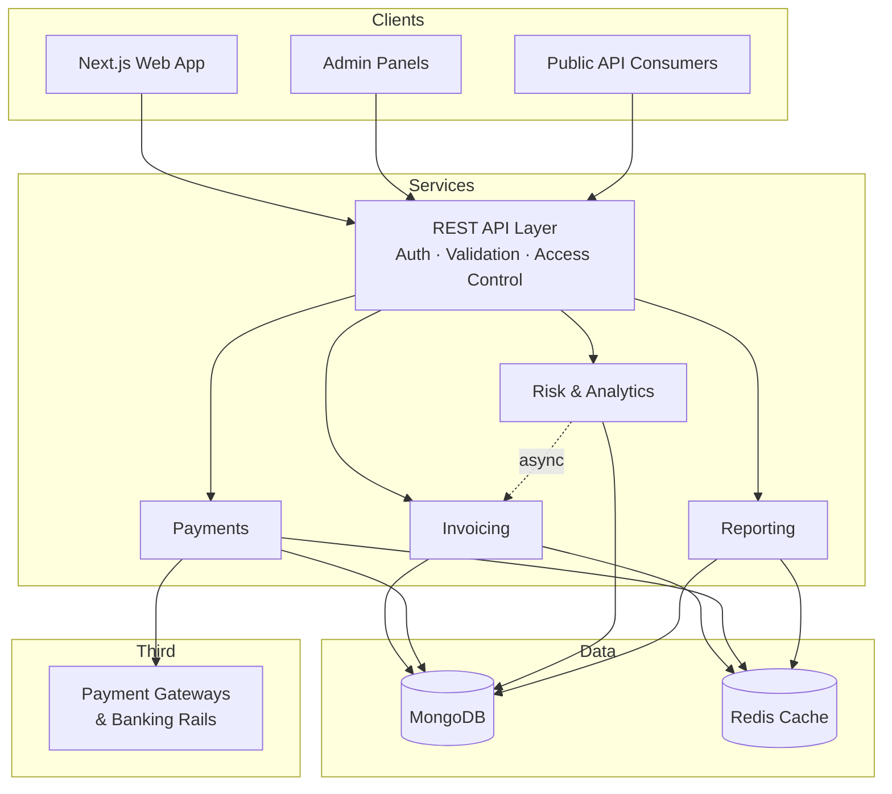

# InvoiceMate — Full Stack Engineer

**Full Stack Engineer** working on a payment-enabled invoicing and invoice-financing platform for SMEs in Pakistan.

Scope of work spanned database schema, REST API design, frontend implementation, third-party payment integration, and deployment.

---

## Product Overview

| | |
| --- | --- |
| **Product** | InvoiceMate — invoicing platform with payment-gateway integration and invoice-based financing for SMEs |
| **Market** | Pakistan · SME / B2B |
| **Role** | Full Stack Engineer |
| **Team** | 2 developers + 1 designer + 1 Senior Software Architect  |
| **Ownership** | Invoicing platform · Dashboard · Admin panels · Public APIs · Risk-scoring service |
| **Stack** | Next.js · React · MUI · Tailwind · Redux · Node.js · Express · Django · MongoDB · Redis · Docker · Azure |

**Context:** SME invoicing in the region largely runs on spreadsheets and emailed PDFs. There is no reliable visibility into whether an invoice was paid, collection cycles are long, and unpaid invoices cannot be converted into working capital. InvoiceMate addresses this in a single flow: create an invoice, accept payment through a local gateway, confirm the payment automatically, and allow the SME to finance against verified receivables.

---

## Skills

**Frontend**
Next.js (React) · React · Tailwind CSS · Material UI (MUI) · Redux · Component architecture · SSR · Data-dense and responsive UI

**Backend**
Node.js · Express.js · Django (Python) · REST API design · JWT authentication · Role-based access control · Input validation · Asynchronous processing

**Data & Infrastructure**
MongoDB · Mongoose · Redis · Docker · Microsoft Azure · CI/CD

**Engineering**
Third-party API integration · Payment gateway integration · Data correctness and reconciliation · End-to-end testing · Cross-team technical coordination · Feature ownership in a small team

---

## Responsibilities

### Invoicing Platform — core product
Owned end to end: invoice creation, delivery, tracking, and payment collection. Covered the data model, API surface, UI, and gateway integration, which allowed changes to be made without cross-team dependencies.

### Dashboard
Business view of revenue, receivables, and invoice status. Developed incrementally as requirements emerged from product, sales, and customer feedback, with surfaces reworked as real usage data clarified what mattered.

### Admin Panels
Internal operations tooling, maintained throughout. A substantial portion of this work was data correctness: figures presented to operators had to reconcile against underlying transaction records. Resolved at the aggregation layer rather than the presentation layer. Also added derived insights so operators could validate accuracy without leaving the product.

### Public APIs
Versioned REST API consumed by third-party clients, sharing the same authentication model as the web application. Built with versioning, scoped permissions, and rate limiting treated as core requirements.

### Risk & Anomaly Scoring — Django service
Independently deployed Python service that evaluates invoices and writes a risk score and category to each record, allowing the team to work from a prioritised queue instead of reviewing every invoice. Deployed as a sidecar to the core API so scoring rules could be revised without affecting the invoicing or payment path.

---

## Selected Work

**Automated risk scoring.** Built the invoice scoring service that flagged approximately **80% of fraudulent and test invoices** submitted to the platform, allowing a small operations team to work a prioritised review queue.

**Payment gateway integration.** Integrated **JazzCash** and **EasyPaisa**, coordinating directly with provider engineering teams to establish correct API behaviour where documentation was incomplete or conflicting. Additional payment rails were added as provider integrations became available.

**Duplicate invoice prevention.** Enforced a compound-field uniqueness check at the data layer, with manual review retained for legitimate edge cases, to protect the integrity of receivables records used in financing decisions.

**Reporting accuracy.** Investigated and resolved discrepancies between reported figures and underlying transaction data by correcting the underlying aggregation logic, then extended the admin views with additional insights.

**Test strategy.** Implemented end-to-end testing as the primary verification layer, targeting the payment and integration paths where defects carry direct financial and operational consequences.

---

## Technical Decisions

| Decision | Rationale |
| --- | --- |
| **Single core API as system of record** | One authentication model, one validation layer, and one source of truth for invoice and payment state. Simpler to operate and reason about than a distributed stack at this team size. |
| **Analytics as an async sidecar** | Isolated scoring and reporting from the request path, so changes to analysis logic did not require changes to the payment path. |
| **Redis for aggregation-heavy reads** | Dashboard and admin endpoints were recomputing aggregates on each request; caching these offloaded work from the primary database. |
| **Stateless JWT authentication** | Horizontally scalable without session affinity, and a single model served both the web application and public API consumers. |
| **Mongoose schemas over rigid records** | Invoice line items and provider payload structures vary between integrations; schema flexibility avoided a migration for each variation. |
| **E2E-first testing** | Prioritised coverage of integration and payment flows over breadth of unit-level coverage. |

---

## Architecture

Invoice creation remains on the synchronous request path. Scoring and reporting run asynchronously against the same records.

---

Open to work in **fintech, payments, or B2B SaaS**.
